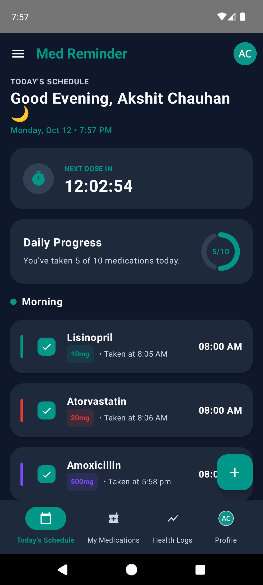
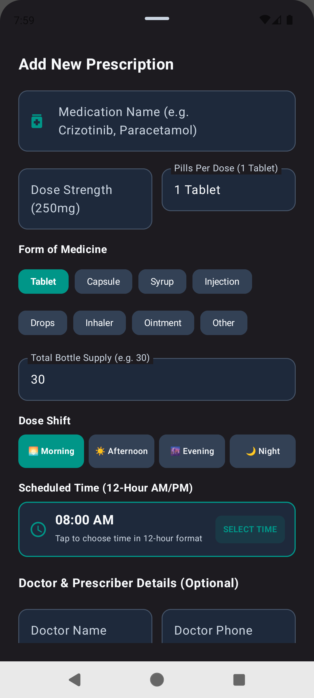
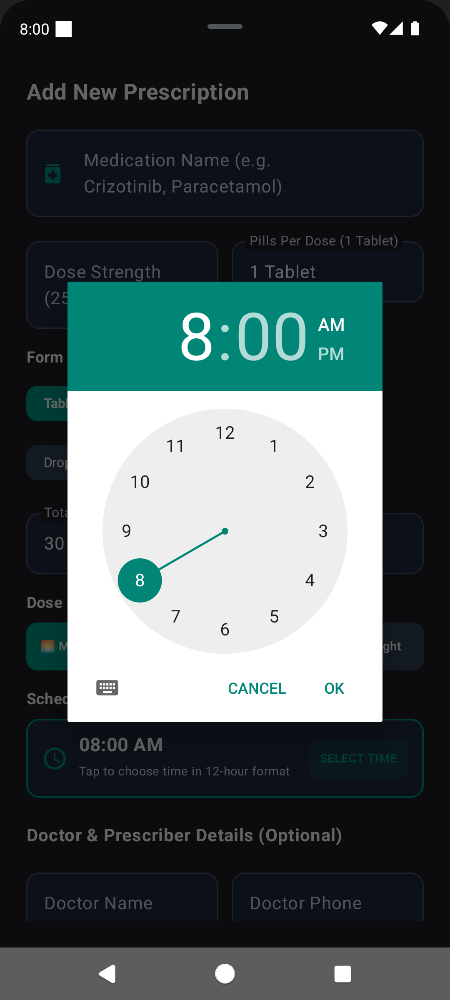
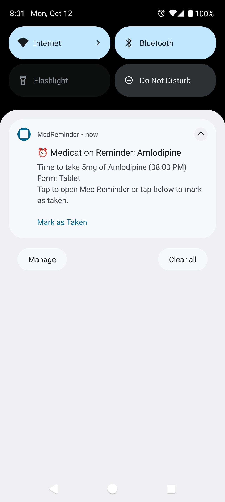
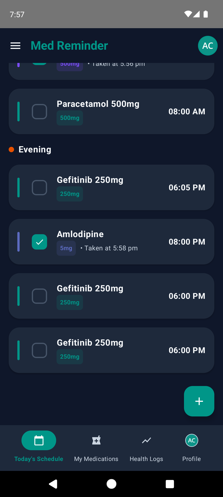

# 💊 MedReminder - Smart Medication Tracker & Health Companion

[](https://developer.android.com/)
[](https://kotlinlang.org/)
[](https://developer.android.com/jetpack/compose)
[](https://m3.material.io/)
[](https://developer.android.com/topic/architecture)
[](https://developer.android.com/training/data-storage/room)
[](https://firebase.google.com/)
[](https://dagger.dev/hilt/)

**MedReminder** is a modern, privacy-focused, and intelligent Android application designed to help individuals adhere to their medical schedules seamlessly. Built entirely with **Jetpack Compose**, **Material 3**, and **Clean Architecture**, it offers exact on-time reminders, offline-first local persistence, and real-time cloud synchronization via Firebase.

---

## 📱 App Screenshots

| Today's Schedule & Countdown | Add Medication & Pickers | 12-Hour AM/PM Time Dial |
| :---: | :---: | :---: |
|  |  |  |

| Actionable Alarm Notification | Night Schedule Block |
| :---: | :---: |
|  |  |

---

## ✨ Key Features

- ⏰ **Reliable On-Time Push Notifications & Alarms**
  - Uses Android's `AlarmManager.setAlarmClock()` and `setExactAndAllowWhileIdle()` to pierce Android Doze mode and aggressive battery optimizations.
  - Actionable notifications allow users to **"Mark as Taken"** directly from the notification tray without opening the app.
  - Automatically re-schedules repeated daily doses.
  - Includes a `BootReceiver` that restores all scheduled alarms immediately upon device reboot.

- 📅 **Dynamic "Today's Schedule" Timeline**
  - Doses are automatically segmented into chronological shifts: **🌅 Morning**, **☀️ Afternoon**, **🌆 Evening**, and **🌙 Night**.
  - Live countdown banner calculating the exact time remaining until the next scheduled dose.
  - Real-time dose status updates (Upcoming, Taken, or Skipped).

- 💊 **Intuitive Medication Entry & Option Pickers**
  - **Form Chips:** Single-tap selection for dosage forms (`Tablet`, `Capsule`, `Syrup`, `Injection`, `Drops`, `Inhaler`, `Ointment`, `Other`).
  - **Shift Chips:** Quick selection between shifts with smart auto-selection based on chosen time.
  - **12-Hour Native Time Picker:** Interactive AM/PM clock dial strictly enforcing the `hh:mm a` format across the app.

- ☁️ **Offline-First & Cloud Synchronization**
  - Fast, fully functional offline access powered by **Room Database**.
  - Seamless two-way cloud sync with **Cloud Firestore** and **Firebase Authentication** (Google Sign-In).
  - Medications, dose logs, and inventory restore automatically whenever you sign in or switch devices.

- 📊 **Adherence History & Health Tracking**
  - Comprehensive dose history logs with time stamps.
  - Adherence score calculation and streak tracking to keep users motivated.

- 🔍 **Drug Information & Lookup**
  - Integrates with the **RxNorm / NLM Drug API** to fetch dosage guidelines and drug interactions.

- 🌓 **Material You Design & Adaptive Themes**
  - Supports dynamic Light and Dark themes with edge-to-edge layouts.
  - Follows Google's latest Material Design 3 guidelines with rich typography and smooth animations.

---

## 🏗️ Architecture & Tech Stack

MedReminder adheres strictly to Android development best practices and Clean Architecture principles:

```
app/
 ├── data/
 │    ├── auth/          # Firebase Google Sign-In & Auth repository
 │    ├── local/         # Room Database, DAOs, and Entities
 │    ├── remote/        # Retrofit API Service & Models (RxNorm)
 │    └── repository/    # Repository implementations (SSOT pattern)
 ├── di/                 # Dagger Hilt Dependency Injection modules
 ├── domain/             # Domain Models & Repository interfaces
 ├── notifications/      # Exact Alarm Scheduler, Alarm Receiver & Boot Receiver
 ├── ui/
 │    ├── components/    # Reusable Compose widgets & Bottom Sheets
 │    ├── detail/        # Medication detail & dose log screen
 │    ├── history/       # Adherence statistics & history log screen
 │    ├── medications/   # Medication list & pill count inventory
 │    ├── navigation/    # Jetpack Compose Navigation graph
 │    ├── profile/       # User profile, theme settings & cloud sync
 │    ├── schedule/      # Schedule timeline & dose countdown
 │    ├── splash/        # Splash screen & onboarding flow
 │    └── theme/         # Color palettes, typography & Material 3 theme
 └── util/               # Time normalization & shift inference utilities
```

### Libraries & Tools

| Component | Library / Framework |
| :--- | :--- |
| **Language** | Kotlin 2.0+ with Kotlin Symbol Processing (KSP) |
| **UI Toolkit** | Jetpack Compose (BOM) & Material Design 3 |
| **Dependency Injection** | Dagger Hilt 2.51+ |
| **Database** | Jetpack Room (Offline persistence) |
| **Networking** | Retrofit 2, OkHttp 3, Gson |
| **Cloud & Auth** | Firebase Authentication, Google Play Services Auth, Cloud Firestore |
| **Image Loading** | Coil Compose |
| **Alarms & Background** | Android `AlarmManager`, `BroadcastReceiver` |

---

## 🚀 Getting Started

### Prerequisites

1. **Android Studio**: Android Studio Ladybug (2024.2.1) or newer recommended.
2. **JDK**: Java Development Kit 17 or higher.
3. **Android SDK**: Min SDK 26 (Android 8.0), Target SDK 35 (Android 15).
4. **Google Account & Firebase**: A Firebase project with Authentication (Google Sign-In) and Firestore enabled.

### Installation

1. **Clone the repository:**
   ```bash
   git clone https://github.com/AkshitChauhan19/MedReminder.git
   cd MedReminder
   ```

2. **Add Firebase Configuration (`google-services.json`):**
   - For security, `google-services.json` is excluded from git tracking. A template is provided at `app/google-services.json.example`.
   - Create a project on the [Firebase Console](https://console.firebase.google.com/).
   - Add an Android app with package name: `com.example.medreminder`.
   - Download the generated `google-services.json` file.
   - Place `google-services.json` in the `app/` directory:
     ```
     MedReminder/
      └── app/
           ├── google-services.json          <-- your real Firebase config (git-ignored)
           └── google-services.json.example  <-- template
     ```

3. **Build the project:**
   ```bash
   # On Windows (PowerShell / Command Prompt)
   .\gradlew.bat assembleDebug

   # On macOS / Linux
   ./gradlew assembleDebug
   ```

4. **Run on an Emulator or Physical Device:**
   - Open the project in Android Studio.
   - Select your target device and click **Run (Shift + F10)**.

---

## 🔒 Permissions & Security

| Permission | Purpose |
| :--- | :--- |
| `SCHEDULE_EXACT_ALARM` / `USE_EXACT_ALARM` | Ensures dose reminders trigger at the exact scheduled second |
| `POST_NOTIFICATIONS` | Displays heads-up medication reminder notifications on Android 13+ |
| `RECEIVE_BOOT_COMPLETED` | Automatically re-registers scheduled alarms after phone restarts |
| `VIBRATE` & `WAKE_LOCK` | Alerts users reliably even if the phone is asleep or muted |
| `INTERNET` & `ACCESS_NETWORK_STATE` | Synchronizes data with Cloud Firestore and queries the RxNorm API |

---

## 👨‍💻 Author

**Akshit Chauhan**  
- GitHub: [@AkshitChauhan19](https://github.com/AkshitChauhan19)

---

## 📄 License

This project is licensed under the [MIT License](LICENSE) - feel free to use, modify, and distribute as per license conditions.
